# Activity 4.2: Graphics Lab (Units 3 and 4)

One Pygame-CE application that covers the main ideas of Units 3 and 4 of NCSD302. All the demos run in the same window. You pick a demo from the sidebar, explore it on the canvas, and read the formulas and live values in the panel on the right.

| Key | Demo                     | Lecture       | Modes (Tab to switch)                                             |
| --- | ------------------------ | ------------- | ----------------------------------------------------------------- |
| 1   | 2D Transformations       | 3.1           | Build · Pivot rotation · Order matters                            |
| 2   | 3D Transformations       | 3.1           | Build · Slide examples                                            |
| 3   | Viewing and Projection   | 3.2           | Camera and view matrix · Projection                               |
| 4   | Clipping                 | 3.3           | Points · Cohen–Sutherland · Sutherland–Hodgman · Viewport mapping |
| 5   | Illumination and Shading | 3.4           | One point · Shading · Side by side                                |
| 6   | Z-Buffer                 | 3.4           | One pixel · Triangles                                             |
| 7   | Scan Conversion          | 3.5           | DDA · Bresenham · Midpoint circle · Scan-line fill                |
| 8   | Colour Models            | 4.1           | RGB, HSV, HSL · Mixing · Interpolation · Brightness vs colour     |
| 9   | Colour on the Display    | 4.1           | Gamma · Clamp and quantise · Dithering                            |
| 0   | Objects to Pixels        | end of Unit 3 | The whole pipeline in 9 stages                                    |

Every demo opens with the numbers from the lecture's worked examples, so students can check the app against their notes.

## Setup

Windows:

```powershell
py -m venv .venv
.venv\Scripts\activate
py -m pip install -r requirements.txt
```

macOS and Linux:

```bash
python3 -m venv .venv
source .venv/bin/activate
python3 -m pip install -r requirements.txt
```

## Run

```bash
python3 main.py              # macOS and Linux
py main.py                   # Windows
```

To check the mathematics against the lecture examples (no window opens):

```bash
python3 -m tests.test_matrices     # Lecture 3.1, 2D
python3 -m tests.test_graphics     # Lectures 3.1 (3D) to 4.1
```

To save one frame of any demo and mode without opening the window:

```bash
python3 main.py --preview shot.png --demo 7 --mode 2
```

## Controls That Work Everywhere

- `1`–`9`, `0` or click the sidebar: choose a demo
- `Tab` or click a header tab: next mode
- `Backspace`: reset the current mode
- `Ctrl+S` / `Cmd+S`: save a screenshot in `screenshots/`
- `Esc` or the window close button: quit

Demos that run an algorithm step by step all use the same keys: `Space` takes one step, `P` plays or pauses, and `Enter` runs to the end. The footer always lists the keys for the current mode.

## How the Code Is Organised

```
Graphics Lab/
  main.py                      creates the App and registers the ten demos
  core/                        the common window: no graphics theory in here
    app.py                     App: window, main loop, switching demos
    demo.py                    Demo and Mode: the base classes every demo uses
    widgets.py                 Button, Slider, Sidebar, Header, InfoPanel, ControlsBar
    viewport.py                Viewport2D: world coordinates -> screen pixels
    pixel_grid.py              PixelGrid: a magnified raster of big square pixels
    stepper.py                 StepPlayer: runs an algorithm one step at a time
    draw_utils.py              labels, arrows, dashed lines, legends, NumPy image display
    theme.py                   layout, colours, fonts
  graphics/                    the lecture content: NumPy only, no Pygame
    matrices.py                2D homogeneous matrices                  (3.1)
    transforms3d.py            3D homogeneous matrices                  (3.1)
    camera.py                  Camera, view matrix, projection          (3.2)
    clipping.py                outcodes, Cohen–Sutherland, Sutherland–Hodgman, viewport  (3.3)
    lighting.py                the Phong reflection model               (3.4)
    mesh.py                    sphere and cube meshes
    triangle_raster.py         triangle filling, interpolation, Z-buffer (3.4, 3.5)
    raster.py                  DDA, Bresenham, midpoint circle, scan-line fill  (3.5)
    colour.py                  RGB/HSV/HSL/CMYK, gamma, quantisation, dithering (4.1)
  demos/                       one file per demo; each mode is one class
  tests/                       checks every graphics/ module against the lecture examples
  previews/                    screenshots used below
```

The split matters for students:

- **`graphics/`** is what they should read to learn. Each function points to the slide it implements, and none of it uses Pygame.
- **`demos/`** decides what to show and how to react to the keyboard and mouse.
- **`core/`** makes every demo look and behave the same way.

When a lecture is about how pixels are chosen (scan conversion, shading, the Z-buffer), the pixels come from our own algorithms. Pygame only paints the squares. `pygame.draw` is used for labels, overlays and the "ideal" shapes drawn for comparison.

### Demo and Mode

A **Demo** is one sidebar entry. A **Mode** is one way of exploring it. Each Mode overrides a few methods:

| Method                | Called when                           | Typical job                               |
| --------------------- | ------------------------------------- | ----------------------------------------- |
| `handle_event(event)` | a key is pressed or the mouse is used | change a parameter                        |
| `update(dt)`          | every frame                           | move an animation or a StepPlayer forward |
| `draw(surface)`       | every frame                           | draw onto the canvas                      |
| `info_sections()`     | every frame                           | return the text for the right-hand panel  |
| `reset()`             | Backspace is pressed                  | go back to the starting values            |

### Algorithms as generators

The step-by-step algorithms (`raster.bresenham_line`, `clipping.cohen_sutherland_steps`, `clipping.sutherland_hodgman_stages` and others) are Python **generators**: each `yield` hands back one decision. A `StepPlayer` takes those steps out one at a time when you press Space. To get the whole result at once, call `list(...)` on the generator.

## The Demos

### 1. 2D Transformations (Lecture 3.1)

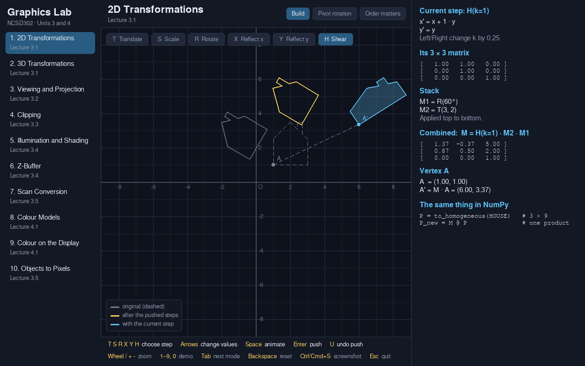

- **Build:** apply T, S, R, reflection or shear (keys `T S R X Y H`, or the toolbar). The arrows change the values and `Space` animates the step. `Enter` pushes it onto a stack and `U` undoes. The panel shows M = Mk · … · M1.
- **Pivot rotation:** T(−a, −b), R(θ) and T(a, b), one step per `Space`. Click to move the pivot. The defaults reproduce P = (4, 1) about C = (2, 1) → (2, 3).
- **Order matters:** T · R next to R · T, with `np.allclose` used to check whether they are equal.

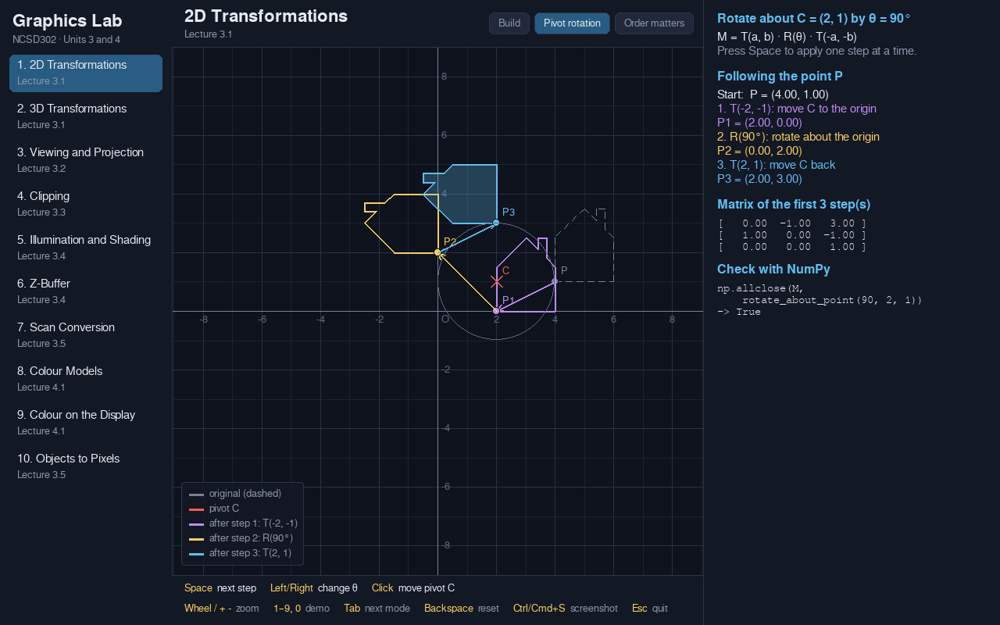

### 2. 3D Transformations (Lecture 3.1)

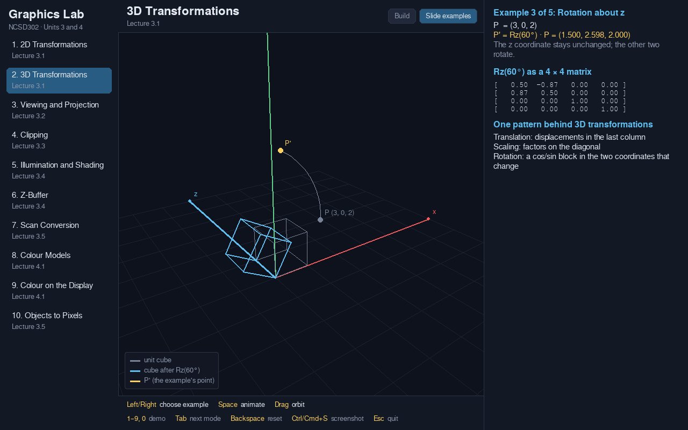

- **Build:** translate, scale and rotate about x, y or z (`T S X Y Z`), with 4 × 4 matrices and a stack. `[ ]` change the z component.
- **Slide examples:** the five worked examples, chosen with `Left`/`Right`. The highlighted rotation axis and the arc traced by P show which coordinate stays unchanged.
- Drag to orbit the display camera. This moves the observer, not the cube.

### 3. Viewing and Projection (Lecture 3.2)

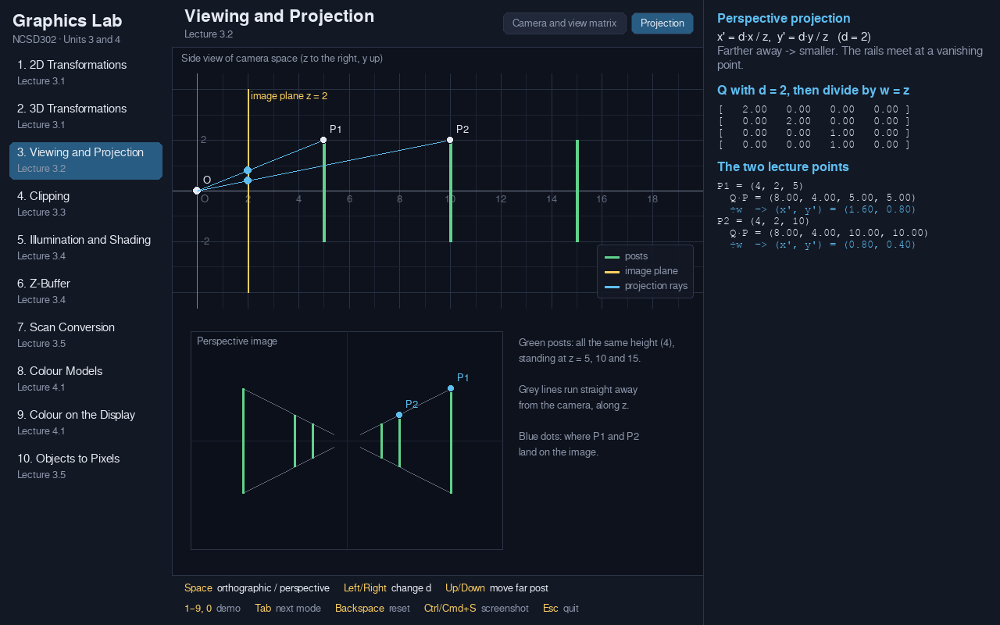

- **Camera and view matrix:** a top-down map of the world. Drag E or C, turn with `Left`/`Right` and move with `Up`/`Down`. The panel builds f, r and u and the view matrix V, then follows Pw = (8, 4, 3) to Pc. The inset shows what the camera sees.
- **Projection:** `Space` switches between orthographic and perspective. The side view shows the rays and the image shows equal posts shrinking with depth. Rails along z meet at a vanishing point in perspective and collapse to points in orthographic. The lecture's points P1 and P2 are tracked through Q and the divide by w.

### 4. Clipping (Lecture 3.3)

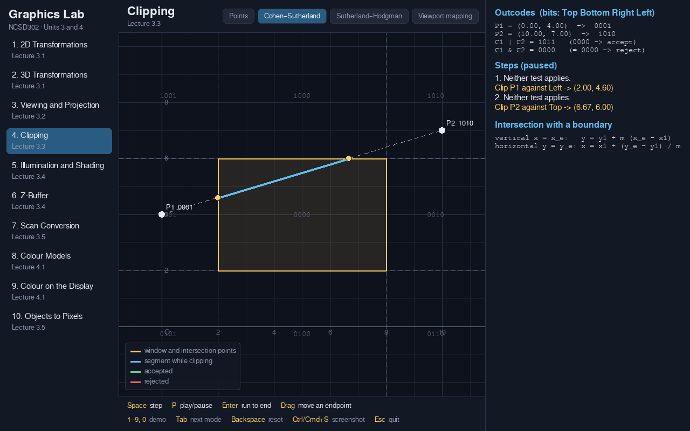

- **Points:** click to add points, each tested against the four inequalities.
- **Cohen–Sutherland:** the outcodes in all nine regions, and the OR and AND tests. Each `Space` shows one replacement. The default line (0, 4)–(10, 7) gives A (2, 4.6) and B (6.67, 6). Drag the endpoints to try other lines.
- **Sutherland–Hodgman:** one boundary per `Space`. Each edge's rule (in→in, in→out, out→out, out→in) and the output list are shown. Drag the vertices.
- **Viewport mapping:** move the mouse over the world and watch P map to screen pixels. `I` turns the y inversion off, which flips the picture upside down.

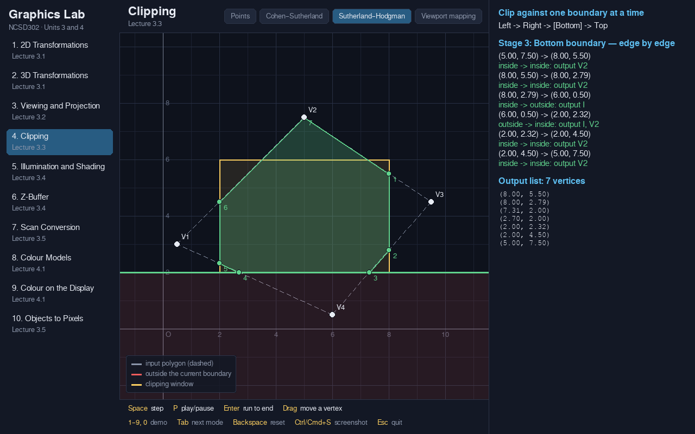

### 5. Illumination and Shading (Lecture 3.4)

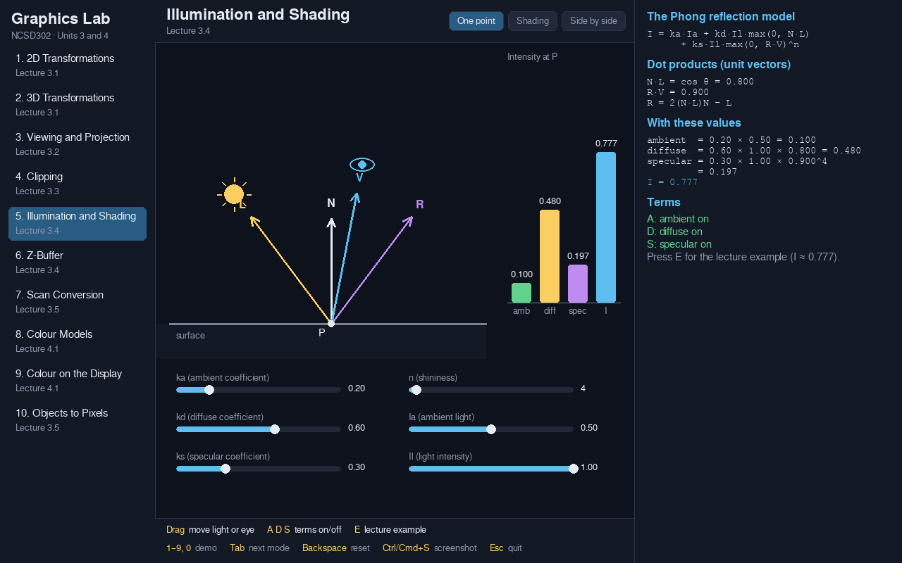

- **One point:** drag the sun (L) and the eye (V). The bars show the ambient, diffuse and specular terms, and the sliders set ka, kd, ks, n, Ia and Il. `E` loads the worked example (I ≈ 0.777).
- **Shading:** a low-poly sphere drawn by our own triangle filler with a Z-buffer. `F G P` switch between flat, Gouraud and Phong shading. Drag to move the light, `Up`/`Down` change the shininess, `[ ]` change the mesh, `W` shows the wireframe and `A D S` toggle the three terms.
- **Side by side:** all three shading methods at once, with the number of lighting evaluations under each.

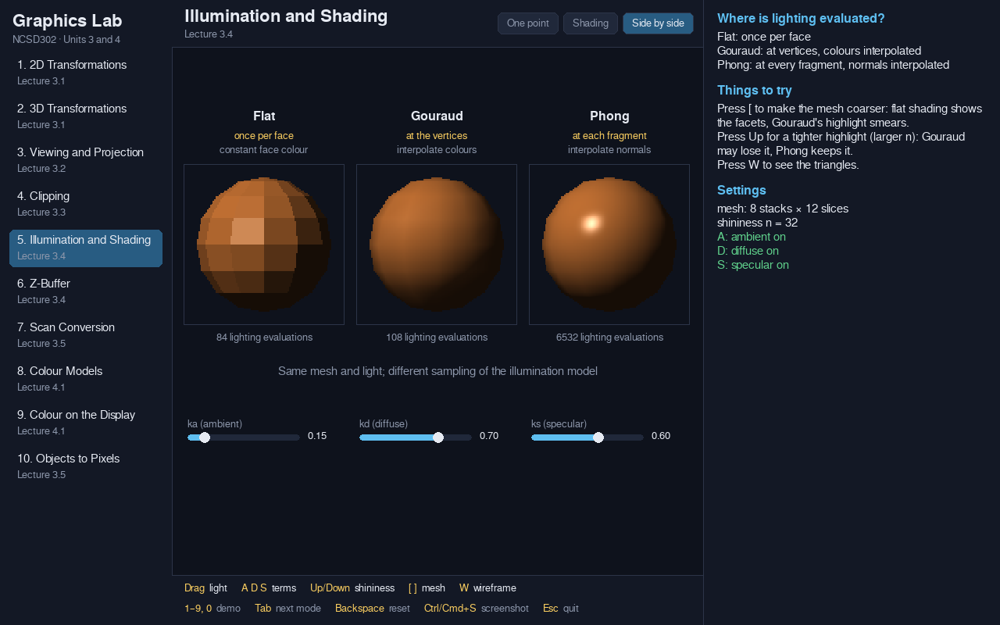

### 6. Z-Buffer (Lecture 3.4)

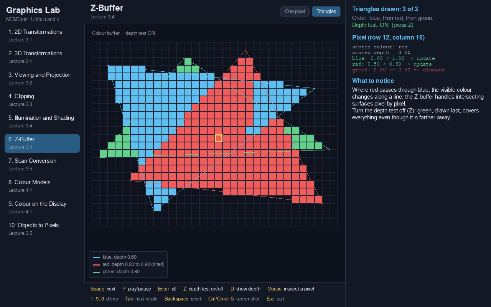

- **One pixel:** the slide's walkthrough. Blue arrives at 0.60, red at 0.35 (update) and green at 0.80 (discard).
- **Triangles:** three triangles in a 32 × 24 framebuffer, and the tilted red one passes through the blue one. Hover over any pixel to see its history. `D` shows the depth buffer and `Z` turns the depth test off, so the last triangle drawn wins.

### 7. Scan Conversion (Lecture 3.5)

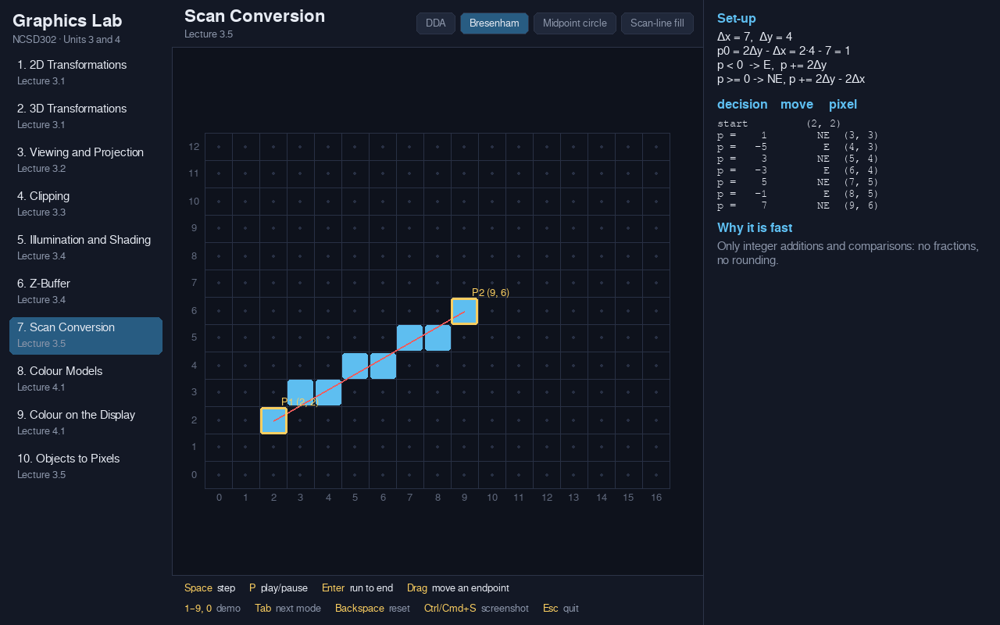

- **DDA:** exact positions in yellow and rounded pixels in blue. The default line (2, 2)–(7, 5) matches the lecture.
- **Bresenham:** a table of p_k values and the E/NE candidates for the next step. The default line (2, 2)–(9, 6) gives p = 1, −5, 3, −3, 5, −1, 7. Drag the endpoints to try any slope.
- **Midpoint circle:** the computed octant in yellow and its seven reflected copies in blue, with the midpoint M marked. R = 5 by default, and `Up`/`Down` change the radius.
- **Scan-line fill:** one scan line per step, showing the crossings, even-odd spans and filled pixels. `N` cycles through the polygons: the U shape gives 2, 5, 8, 11 at y = 6, and the arrow has vertex special cases.

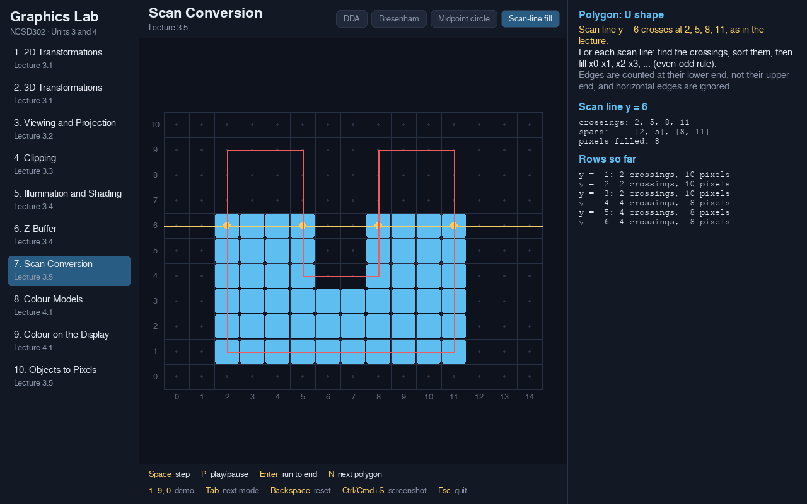

### 8. Colour Models (Lecture 4.1)

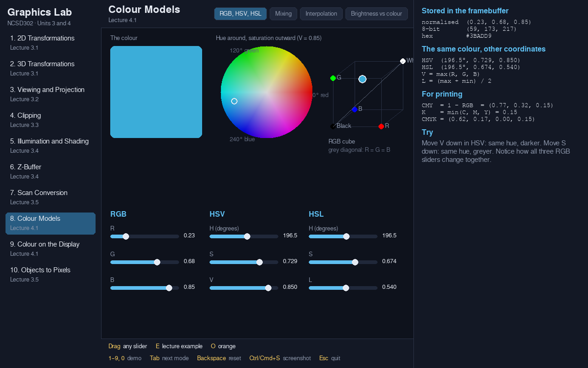

- **RGB, HSV, HSL:** three linked groups of sliders, a hue/saturation wheel and the RGB cube. The panel shows the 8-bit value, hex code, CMY and CMYK. `E` loads (0.23, 0.68, 0.85) and `O` loads orange (#FF8000).
- **Mixing:** additive lights on black next to subtractive inks on white.
- **Interpolation:** the same two colours blended in RGB, HSV and HSL. `N` gives the next pair.
- **Brightness vs colour:** a generated picture split into luminance-like and colour-difference parts.

### 9. Colour on the Display (Lecture 4.1)

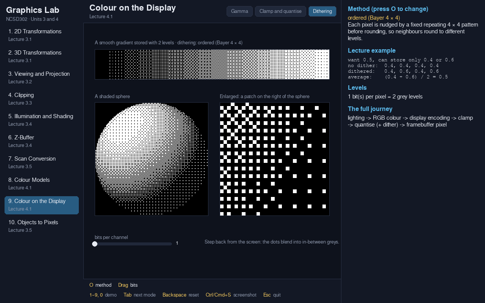

- **Gamma:** the curve I = V^γ, with V = I^(1/γ) encoding. With γ = 2.2, V = 0.5 gives I ≈ 0.22, and I = 0.5 needs V ≈ 0.73.
- **Clamp and quantise:** a computed value goes through clamping to [0, 1], then quantisation at 1–8 bits.
- **Dithering:** none, ordered (Bayer 4 × 4) or error diffusion (Floyd–Steinberg), chosen with `O`, at 1–4 bits, with an enlarged patch.

### 0. Objects to Pixels: the whole pipeline

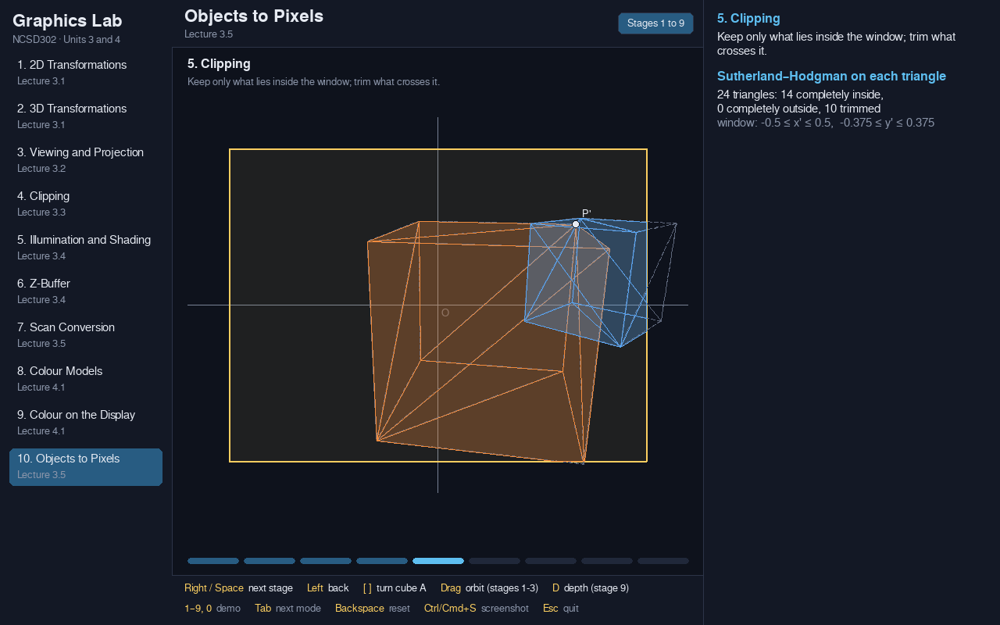

Two cubes go through the nine steps of the "End of Unit 3" slide. Use `Right`/`Space` and `Left` to move between stages, and `[ ]` to turn cube A. The stages are object space, model, view, projection, clipping, viewport mapping, scan conversion, fragment colour (drawn without a depth test, so the overlaps come out wrong), and finally the Z-buffer and framebuffer (`D` shows the depth buffer).

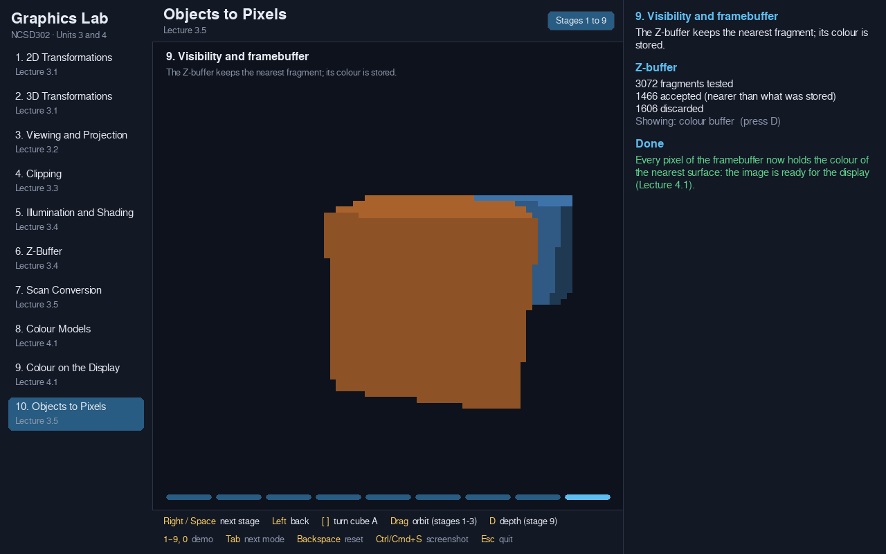

## Suggested Use in Class

Each demo works as a 10–15 minute segment right after its lecture:

1. Start with the lecture's own example, which is the default, and read the panel together with the slide.
2. Ask students to predict the next value before pressing `Space` (the next pixel, outcode or matrix entry).
3. Change one thing (drag an endpoint, move the light, change γ) and ask what will happen first.
4. Open the matching file in `graphics/` and find the lines that produced what was just seen.

Demo 0 makes a good revision session at the end of Unit 3.

## Questions To Ask

- **3.1** Why is the newest step written on the left of the product? When do T · R and R · T agree?
- **3.2** Why does the view matrix use the camera axes as its rows? What happens to rails along z in orthographic projection?
- **3.3** Why can line clipping not be used on its own for polygons? What does a 1 bit in an outcode mean?
- **3.4** Why does Gouraud shading miss a tight highlight that Phong shading keeps? Would the Z-buffer's result change if the triangles arrived in another order?
- **3.5** Which operations does Bresenham avoid that DDA needs? Why does a local-minimum vertex count as two crossings?
- **4.1** Why is the RGB midpoint of red and cyan grey? Why do printers add black ink? What does dithering trade away?

## Adding Another Demo

1. Put the mathematics in a new file under `graphics/`, using NumPy and no Pygame, and add checks to `tests/`.
2. In `demos/`, write one `Mode` subclass for each way of exploring the topic, and a `Demo` subclass whose `setup()` creates them.
3. Register it in `main.py` with `app.register(MyNewDemo())`. It appears in the sidebar automatically.
